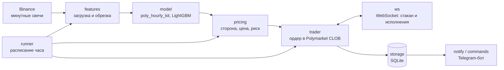

# Polymarket BTC Up/Down: торговый бот с ML-моделью

Бот торгует часовыми рынками Polymarket «Bitcoin Up or Down». Каждый час
LightGBM-модель предсказывает, закроется ли часовая свеча BTC/USDT на Binance
выше открытия. За две минуты до начала часа бот выставляет лимитный ордер
на эту сторону. Через час рынок резолвится, бот считает P&L и присылает итог
в Telegram.

Проект закрывает весь путь от данных до денег: исследование и walk-forward
валидация модели, исполнение ордеров через API биржи, учёт сделок, мониторинг.

## Как устроен один час

```
H − 2 мин   минутки Binance → 22 признака → p(Up) → лимитный ордер по 0.51
H … H+12м   ждём исполнения (WebSocket), потом остаток добираем по рынку
H + 1ч      рынок резолвится по свече Binance: close ≥ open → Up
H + 1ч 1м   исход, P&L, запись в SQLite, сообщение в Telegram
```

## Архитектура



| Модуль | Что делает |
|---|---|
| `main.py` | CLI: `doctor`, `check`, `run`, `stats`, `retrain`, `replay` |
| `config.py` | все настройки в одном месте; секреты только из `.env` |
| `app/runner.py` | планировщик: решение → ордер → исполнение → резолв |
| `app/features.py`, `app/model.py` | данные Binance и прогноз модели, hot-reload после переобучения |
| `app/markets.py` | поиск рынка по слагу, проверка правила резолва, стакан |
| `app/pricing.py`, `app/risk.py` | цена входа, потолок цены, дневной и месячный лимиты убытка |
| `app/trader.py` | `ClobTrader` (реальные ордера) и `PaperTrader` (симуляция по стакану) с одним интерфейсом |
| `app/ws.py` | WebSocket-подписки на свои ордера и живой стакан |
| `app/storage.py` | SQLAlchemy + SQLite: журнал решений и бухгалтерия |
| `app/doctor.py` | проверка готовности: `.env`, сеть, рынок, модель, база, Telegram |
| `app/replay.py` | прогон схемы исполнения по записанному стакану и ленте сделок |
| `app/notify.py`, `app/commands.py`, `app/charts.py` | уведомления, команды и графики в Telegram |
| `poly_hourly_kit/` | модель отдельным пакетом: признаки, самопроверка, переобучение |
| `tests/` | pytest: исполнение ордеров, проверки готовности, статистика |

## Модель

- **Цель** — ровно правило резолва рынка: `close ≥ open` часовой свечи Binance.
- **Признаки** — 22 штуки по прошлым часам: доходности, z-score, волатильность,
  ATR, форма свечи, объём, RSI, серия свечей, время суток и день недели.
- **Валидация** — walk-forward: окно обучения 4 года, зазор 7 дней, проверка 30 дней,
  37 фолдов, 26 280 часов вне обучения.
- **Результат** — точность 53.65%. Простое правило «против двух одинаковых свечей
  подряд» даёт 52.58%. Разница значима по тесту Макнемара (p = 0.0016), модель
  выше 50% во всех 37 окнах.
- **Защита от утечек** — данные обрезаются моментом решения в двух местах,
  а файл признаков сверяется по контрольной сумме при каждом импорте.
  Самопроверка пересчитывает 200 эталонных часов с нулевым допуском.

Подробности — в [`poly_hourly_kit/README.md`](poly_hourly_kit/README.md).

## Что показала живая торговля

Бот торговал реальными деньгами во второй половине сентября 2026 года.
За 410 часов модель угадала 51.2%, исполненные ставки — 50.1%, итог −$48.84.

Главный вывод: запас модели над безубытком — 2–3 п.п., и его съедает исполнение.
Лимитка по 0.51 чаще исполняется, когда цена идёт против нас, а неисполненные
ордера угадывались на 65%. Анализ на 26 тыс. часах показал, что режим рынка
(ATR, объём, Fear & Greed, фандинг) на точность не влияет. Влияет уверенность
модели: у верхних 20% прогнозов точность 58%, у нижних 40% — 51%. Следующий шаг —
торговать только уверенные часы.

## Запуск

Нужен Python 3.11+.

```bash
python3 -m venv .venv && .venv/bin/pip install -r requirements.txt
cp .env.example .env               # ключ кошелька Polymarket и токен Telegram
.venv/bin/python main.py doctor    # проверки без торговли
.venv/bin/python main.py run       # рабочий цикл
```

`DRY_RUN = True` в `config.py` включает бумажную торговлю: ордера не отправляются,
исполнение моделируется по живому стакану.

Тесты: `.venv/bin/python -m pytest`.

## Стек

Python, LightGBM, pandas, NumPy, SQLAlchemy/SQLite, WebSocket, py-clob-client
(Polymarket CLOB API), Telegram Bot API, matplotlib, loguru, pytest.
