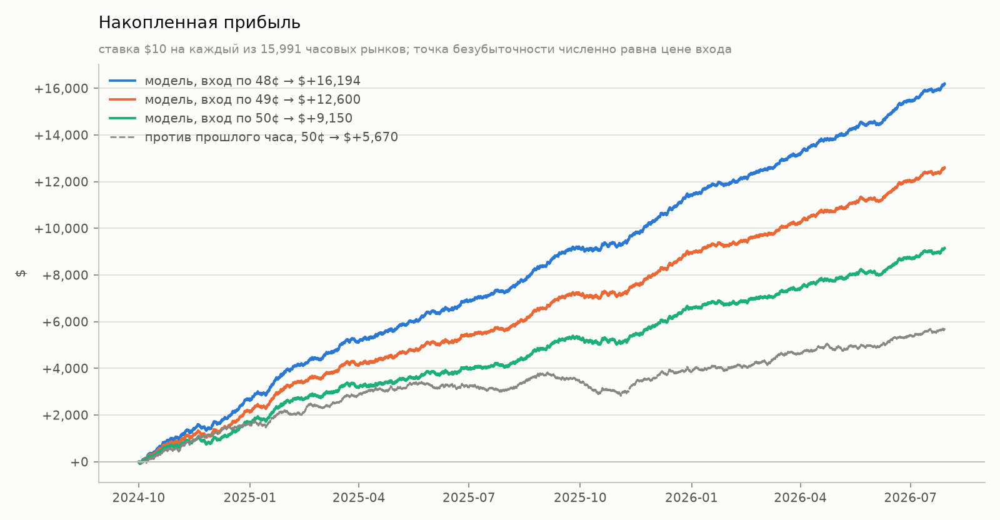
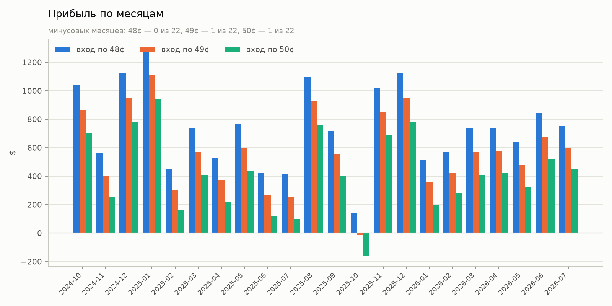
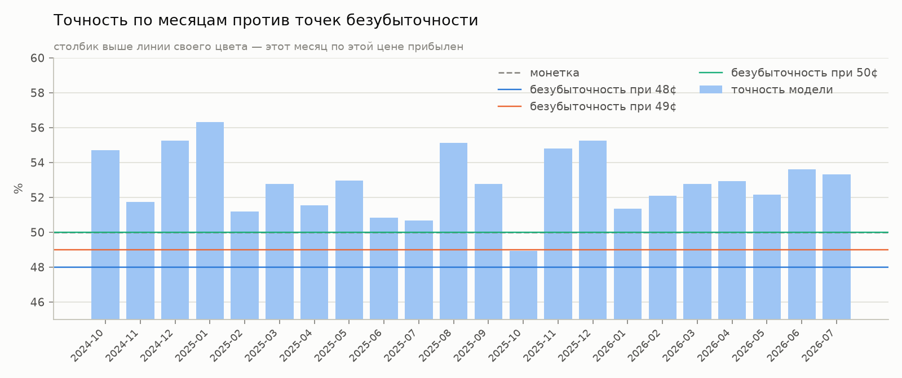
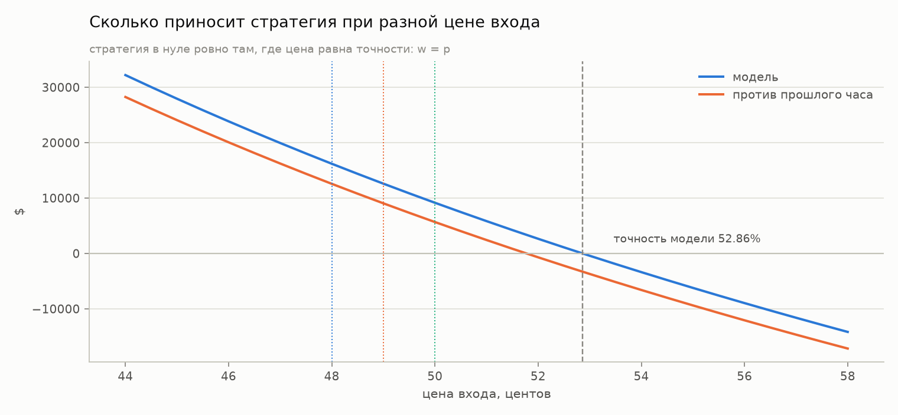
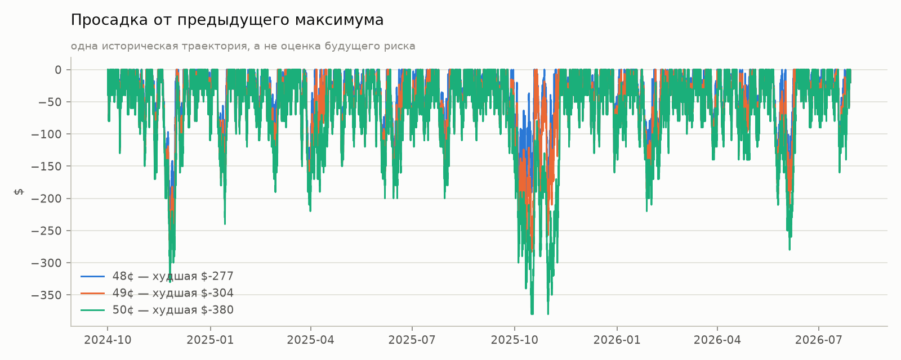
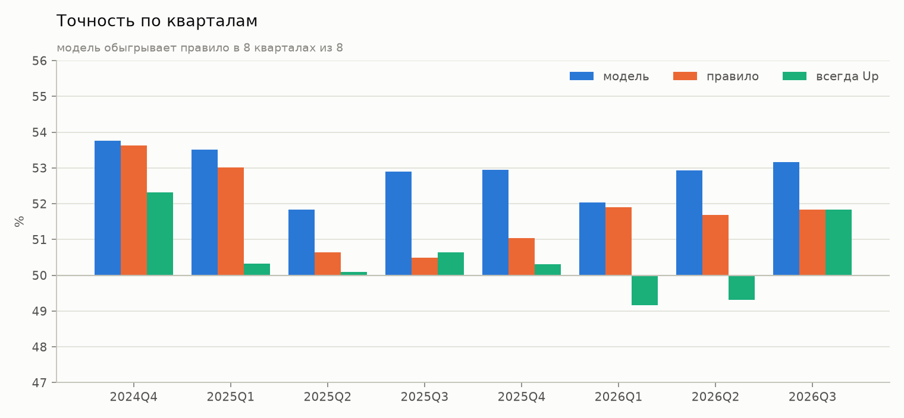
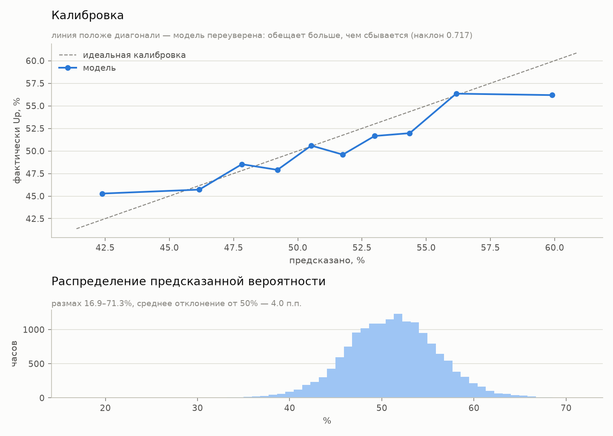
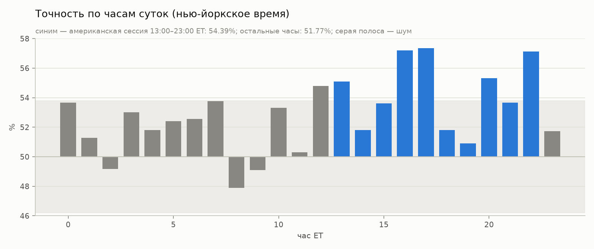

# Модель для часовых рынков Polymarket: обучение, проверка, деньги

Дата: 2026-07-29. Код: [features.py](features.py) — признаки, [validation.py](validation.py) —
схема проверки, [retrain.py](retrain.py) — обучение, [analysis.py](analysis.py) — деньги
и графики.

```bash
python research/retrain.py --cutoff 2     # обучение и walk-forward
python research/analysis.py               # деньги и графики
```

---

## Коротко

Модель переобучена на правиле, по которому рынок **действительно** резолвится, и на
данных, которые **действительно** доступны в момент выставления ордера.

| | |
|---|---|
| точность вне обучения | **52.86%** (интервал 52.08–53.64) |
| часов в проверке | 15 991 (2024-10-01 → 2026-07-29) |
| контрарное правило на том же входе | 51.77% |
| перевес модели | **+1.09 п.п.**, p=0.003, в 8 кварталах из 8 |
| признаков | 5 из 41 |
| прибыль при входе по 50¢ | **+$9 150** за 22 месяца (ставка $10) |
| прибыль при входе по 48¢ | **+$16 194** |
| минусовых месяцев | 1 из 22 (при 48¢ — ни одного) |

Прошлая модель из исследования на этом же — реальном — таргете давала 51.54%, то есть
проигрывала тривиальному правилу. Переобучение вернуло **+1.32 п.п.**

---

## 1. Что изменилось по сравнению с исследованием

### 1.1 Правило резолва

Часовой рынок Polymarket резолвится так (взято из описания рынка через Gamma API):

> This market will resolve to "Up" if the **close price is greater than or equal to the
> open price** for the BTC/USDT **1 hour candle that begins on the time specified in the
> title**.

То есть сравниваются close и open **одной и той же стандартной часовой свечи Binance**
(HH:00:00–HH:59:59), и равенство даёт Up.

Модель исследования училась на другом: close текущего часа против close предыдущего,
по сетке, сдвинутой на минуту (HH:01 → HH+1:00). Расхождение — **6.28% часов**, и стоит
оно почти процентного пункта точности.

### 1.2 Момент принятия решения

Ордер выставляется **за 2 минуты до начала часа**. В этот момент последняя свеча ещё
не закрыта — известны 58 из 60 её минут. Поэтому вся история признаков строится из
одинаково **обрезанных** свечей: у каждой берутся минутки `[:00 … :57]`. Такой ряд
целиком доступен в момент решения, и признаки в обучении считаются ровно так же,
как будут считаться в бою.

Цена этого компромисса измерена — её **нет**:

| вариант | точность | перевес над правилом |
|---|---|---|
| полная свеча (решение в HH:00:00) | 52.72% | +0.84 п.п. (p=0.016) |
| **обрезка 2 мин (решение за 2 мин до)** | **52.86%** | **+1.09 п.п. (p=0.003)** |

Обрезанная не хуже полной — формально даже чуть лучше, хотя разница 0.14 п.п. лежит
глубоко внутри доверительного интервала и означает «одинаково». Ранний вход бесплатен.

### 1.3 Схема проверки

Взята исправленная схема из [разбора методики](../../daily_btc_notebook/claude/ML_REVIEW.md):
модель назначена заранее (никакого выбора лучшей из шести задним числом), окно обучения
и баланс классов убраны из пространства поиска как фальсифицированные, отбор признаков
делает elastic net вместо перебора блоков, внутренних фолдов шесть вместо трёх.
Walk-forward по кварталам с эмбарго 30 дней, подбор параметров строго внутри фолда.

---

## 2. Правила денежного расчёта

* на каждый часовой рынок ставится **$10**, то есть покупается 10/цена шейров;
* выигравший шейр гасится за $1, проигравший за $0;
* лимитка считается исполненной — **это главное допущение, см. §10**;
* комиссии за исполнение лимитного ордера нет;
* ставим на сторону модели всегда, порога уверенности нет.

Всего 15 991 ставка, оборот **$159 910**.

### Ключевая арифметика: безубыточность равна цене входа

При покупке по цене `p` выигрыш даёт `$10 × (1−p)/p`, проигрыш стоит `$10`.
Матожидание нулевое, когда

```
w × (1−p)/p = 1 − w   ⟺   w = p
```

**Точка безубыточности численно равна цене входа.** Купил по 48 центов — хватит 48%
угаданных; купил по 50 — нужно 50%. Между крайними ценами два процентных пункта
требуемой точности, а всё преимущество модели над монеткой — 2.86. Поэтому цена входа
весит не меньше, чем сама модель.

---

## 3. Итог по трём точкам входа

| цена входа | ставок | угадано, % | нужно, % | запас, п.п. | выигрыш даёт, $ | итог, $ | на ставку, $ | ROI, % | просадка, $ | минусовых месяцев |
|---|---|---|---|---|---|---|---|---|---|---|
| **48¢** | 15 991 | 52.86 | 48.0 | **+4.86** | 10.83 | **+16 194** | +1.013 | **+10.13** | −277 | **0 из 22** |
| **49¢** | 15 991 | 52.86 | 49.0 | +3.86 | 10.41 | +12 600 | +0.788 | +7.88 | −304 | 1 из 22 |
| **50¢** | 15 991 | 52.86 | 50.0 | +2.86 | 10.00 | +9 150 | +0.572 | +5.72 | −380 | 1 из 22 |



Все три линии растут почти равномерно все 22 месяца — без периода, который тянул бы
вниз. Серая пунктирная линия внизу — тривиальное правило «против прошлого часа» при
той же цене 50¢; расстояние между ней и зелёной линией и есть вклад модели.

Разброс между ценами огромен при **одной и той же модели и тех же 15 991 ставках**:
48¢ приносит в **1.8 раза** больше, чем 50¢. Отличается только цена, по которой
удалось встать. Каждый цент стоит примерно **$3 500**.

---

## 4. По месяцам



| месяц | 48¢ | 49¢ | 50¢ | ставок | точность, % |
|---|---|---|---|---|---|
| 2024-10 | +1 039 | +866 | +700 | 744 | 54.70 |
| 2024-11 | +561 | +402 | +250 | 721 | 51.73 |
| 2024-12 | +1 123 | +948 | +780 | 744 | 55.24 |
| 2025-01 | +1 289 | +1 111 | +940 | 744 | **56.32** |
| 2025-02 | +447 | +300 | +160 | 672 | 51.19 |
| 2025-03 | +737 | +570 | +410 | 743 | 52.76 |
| 2025-04 | +529 | +371 | +220 | 720 | 51.53 |
| 2025-05 | +768 | +601 | +440 | 744 | 52.96 |
| 2025-06 | +425 | +269 | +120 | 720 | 50.83 |
| 2025-07 | +414 | +254 | +100 | 744 | 50.67 |
| 2025-08 | +1 102 | +927 | +760 | 744 | 55.11 |
| 2025-09 | +717 | +555 | +400 | 720 | 52.78 |
| **2025-10** | **+143** | **−11** | **−160** | 744 | **48.92** |
| 2025-11 | +1 019 | +851 | +690 | 721 | 54.79 |
| 2025-12 | +1 123 | +948 | +780 | 744 | 55.24 |
| 2026-01 | +518 | +356 | +200 | 744 | 51.34 |
| 2026-02 | +572 | +423 | +280 | 672 | 52.08 |
| 2026-03 | +737 | +570 | +410 | 743 | 52.76 |
| 2026-04 | +738 | +576 | +420 | 720 | 52.92 |
| 2026-05 | +643 | +478 | +320 | 744 | 52.15 |
| 2026-06 | +842 | +678 | +520 | 720 | 53.61 |
| 2026-07 | +750 | +597 | +450 | 675 | 53.33 |

Убыточный месяц ровно один — **октябрь 2025** (точность 48.92%), и он убыточен только
при входе по 49–50¢; при 48¢ даже он вышел в плюс. Ни одного месяца ниже 48.9%
за два года.

При преимуществе в 2.86 п.п. и ~725 ставках в месяц теоретически ожидалось бы около
6% минусовых месяцев, то есть примерно 1.4 штуки из 22 — наблюдаемое значение ровно
в этих рамках, никакой аномалии.



Тот же материал под другим углом: столбик выше линии своего цвета — этот месяц по этой
цене прибылен. Видно, насколько разный запас дают 48¢ и 50¢: над синей линией (48¢)
не поднимается только… ничего, все 22 месяца выше.

---

## 5. Против стратегий без модели

| стратегия | точность | 48¢ | 49¢ | 50¢ |
|---|---|---|---|---|
| **модель** | **52.86%** | **+16 194** | **+12 600** | **+9 150** |
| против прошлого часа | 51.77% | +12 569 | +9 049 | +5 670 |
| всегда Up | 50.38% | +7 923 | +4 498 | +1 210 |

При 50¢ модель добавляет к тривиальному правилу **+$3 480** — почти столько же, сколько
стоит один цент цены входа ($3 500). Это тот же баланс, что был найден в исследовании:
работа над исполнением окупается не хуже работы над моделью.

«Всегда Up» при 50¢ даёт лишь +$1 210 на обороте $159 910 — это ровно базовая доля
растущих часов (50.38%), запаса над безубыточностью почти нет.



График показывает главное соотношение наглядно: обе стратегии — прямые линии, каждая
пересекает ноль ровно в точке, равной своей точности. Модель уходит в минус при цене
выше 52.86¢, правило — выше 51.77¢. Всё, что левее, — прибыль; всё, что правее, — убыток.

---

## 6. Риск



| цена входа | худшая просадка | в ставках |
|---|---|---|
| 48¢ | −$277 | 28 |
| 49¢ | −$304 | 30 |
| 50¢ | −$380 | 38 |

Просадки мелкие относительно итога (при 50¢ — 4% от прибыли) и растут с ценой входа
по той же причине, по которой падает прибыль: меньше запас над безубыточностью,
случайные полосы неудач дольше не отыгрываются.

Так и выглядит маленькое, но стабильное преимущество, размазанное по шестнадцати тысячам
ставок: закон больших чисел работает на нас. **Оговорка обязательна:** это просадка на
одной конкретной исторической траектории, а не оценка того, что может случиться.
Будущая полоса невезения ничем не ограничена сверху.

---

## 7. Стабильность по кварталам



| квартал | часов | доля Up | модель | правило | всегда Up |
|---|---|---|---|---|---|
| 2024Q4 | 2 208 | 52.31 | 53.76 | 53.62 | 52.31 |
| 2025Q1 | 2 160 | 50.32 | 53.52 | 53.01 | 50.32 |
| 2025Q2 | 2 184 | 50.09 | 51.83 | 50.64 | 50.09 |
| 2025Q3 | 2 208 | 50.63 | 52.90 | 50.50 | 50.63 |
| 2025Q4 | 2 208 | 50.32 | 52.94 | 51.04 | 50.32 |
| 2026Q1 | 2 160 | 49.17 | 52.04 | 51.90 | 49.17 |
| 2026Q2 | 2 184 | 49.31 | 52.93 | 51.69 | 49.31 |
| 2026Q3 | 679 | 51.84 | 53.17 | 51.84 | 51.84 |

Модель обыгрывает контрарное правило **в 8 кварталах из 8** и базовую линию «всегда Up» —
тоже во всех восьми, при том что сама доля растущих часов гуляет от 49.2% до 52.3%,
то есть рынок за это время побывал и растущим, и падающим.

Слабейший квартал — 2025Q2 (51.83%), но и он выше безубыточности при входе по 50¢.

---

## 8. Калибровка



Линия монотонна — чем выше предсказанная вероятность, тем чаще на деле Up, — но идёт
**положе диагонали**: наклон **0.717**. Это переуверенность: модель обещает больше,
чем сбывается. Там, где она говорит 60%, растущими оказываются 56%.

Для сравнения, у модели из исследования наклон был 0.554 — новая заметно лучше,
но недостаток остался.

Практическое следствие — правило «ставим, если q > цены» ставит **слишком часто**,
а не слишком редко. Где оно ломается:

| цена | ставок | доля рынков | нужно | фактически | запас |
|---|---|---|---|---|---|
| 50¢ | 15 991 | 100% | 50.0% | 52.86% | +2.86 |
| 52¢ | 11 045 | 69% | 52.0% | 53.68% | +1.68 |
| 54¢ | 6 620 | 41% | 54.0% | 54.88% | +0.88 |
| 55¢ | 4 901 | 31% | 55.0% | 55.40% | +0.40 |
| **56¢** | 3 592 | 22% | 56.0% | **55.73%** | **−0.27** |

Отсюда потолок цены входа в конфиге бота — **0.55**. У прошлой модели он был бы 0.53.

Нижняя панель графика: разброс предсказаний узкий, почти всё между 40% и 60%, среднее
отклонение от 50% — всего 4 п.п. Уверенных предсказаний модель не делает вовсе, и это
нормально для задачи с AUC 0.54.

---

## 9. Что модель нашла

Elastic net оставил **5 признаков из 41**, все коэффициенты отрицательные:

| признак | коэффициент | смысл |
|---|---|---|
| `channel_pos6_prev` | −0.0703 | где цена в диапазоне последних 6 часов |
| `close_pos_prev` | −0.0542 | где закрылись внутри своей свечи |
| `channel_pos24_prev` | −0.0159 | то же за сутки |
| `up_share24_prev` | −0.0119 | доля растущих часов за сутки |
| `ma168_dist_delta24_prev` | −0.0093 | отрываемся от недельной средней или возвращаемся |

Отрицательные знаки означают **контрарную стратегию**: чем выше цену занесло внутри
последних часов, тем скорее модель ставит на снижение. Никакого тренда, никакой
волатильности, никакого календаря — только положение цены в коротком диапазоне.

Набор почти совпадает с тем, что elastic net выбирал в исследовании на старом таргете
(`channel_pos6`, `channel_pos24`, `close_pos`) — независимое подтверждение, что сигнал
живёт именно здесь. Природа его известна: отрицательная автокорреляция часовых
доходностей, эффект микроструктуры. Часть «возврата к среднему» — это отскок котировки
между бидом и аском, а не движение рынка.



Сессионное расщепление из исследования воспроизводится и здесь: американские часы
заметно лучше остальных. Оговорка прежняя — разбиение найдено постфактум и слепо
не подтверждено, поэтому в боте по умолчанию торгуем круглосуточно, а проверять его
будем на своих данных.

---

## 10. Что проверено

**Утечка.** Признаки пересобирались на минутках, обрезанных ровно тем моментом, когда
бот будет принимать решение — (H−1):58:00. Расхождение с обучающим путём по всем
признакам — **ровно ноль**. Максимальная корреляция любого признака с таргетом — 0.076.
Точность на обучающей выборке 54.04% против 52.86% вне обучения: разрыв нормальный.

**Интервалы.** Блочный бутстреп по суткам даёт [52.09, 53.64] против биномиального
[52.08, 53.64] — совпадение. Зависимость соседних часов дисперсию не раздувает.

**Подбор параметров.** Внутри каждого фолда, только на обучающей части, по шести
внутренним walk-forward разбиениям. Модель назначена заранее, поэтому смещения
«лучшей из нескольких» здесь нет.

---

## 11. Чего этот расчёт не учитывает

**Главное допущение — что лимитка исполняется.** Оно весит больше, чем всё остальное
вместе. Лимитный ордер на покупку Up по 50¢ исполняется тогда, когда кто-то согласен
продать по 50¢, — а соглашаются охотнее ровно тогда, когда Up менее вероятен.
Достаточно, чтобы такой отбор сдвинул фактическую точность на 2.86 п.п., и от прибыли
при 50¢ не остаётся ничего.

| сдвиг точности | точность | итог при 50¢ |
|---|---|---|
| 0.00 | 52.86% | +$9 150 |
| −1.00 | 51.86% | +$5 950 |
| −2.00 | 50.86% | +$2 750 |
| −2.86 | 50.00% | $0 |

То же и с ценами 48–49¢, только сильнее: чем лучше цена, тем реже её дают. Числа
в колонке 48¢ — не прогноз заработка, а ответ на вопрос «сколько вышло бы, если бы
удавалось встать по 48».

**Ответ на это даст только бумажный прогон** с записью стакана в момент решения —
следующий шаг плана.

Кроме того, за скобками: проскальзывание при частичном заполнении, лимиты ликвидности
конкретного рынка, налоги. И отдельно — **период тот же**, что во всём исследовании
(2024Q4–2026Q3): по-настоящему слепой проверки на данных, которых не существовало
в момент постановки гипотез, ещё не было.

---

## 12. Выводы

1. **Переобучение закрыло блокер.** На реальном рыночном таргете было 51.54% (хуже
   тривиального правила), стало **52.86%** с перевесом над правилом +1.09 п.п.
   (p=0.003) и победой в 8 кварталах из 8.

2. **Ранний вход бесплатен.** Решение за 2 минуты до начала часа по частичной свече
   не уступает решению по полной свече. Ордер успевает встать в стакан до старта рынка,
   и это ничего не стоит по точности.

3. **В деньгах при ставке $10:** +$9 150 при входе по 50¢, +$12 600 при 49¢,
   +$16 194 при 48¢ за 22 месяца. Один убыточный месяц из 22, худшая просадка $380.

4. **Цена входа весит столько же, сколько модель.** Разница между 48¢ и 50¢ —
   $7 044, а всё преимущество модели над тривиальным правилом — $3 480. Один цент
   стоит ~$3 500.

5. **Модель проста до предела:** пять признаков, все контрарные, ядро — положение цены
   в шестичасовом канале.

6. **Главный риск — не модель, а исполнение.** Всё выше посчитано в предположении, что
   лимитка исполняется всегда. Пока это не проверено на реальных котировках, результат
   остаётся расчётным, а не торговым.
